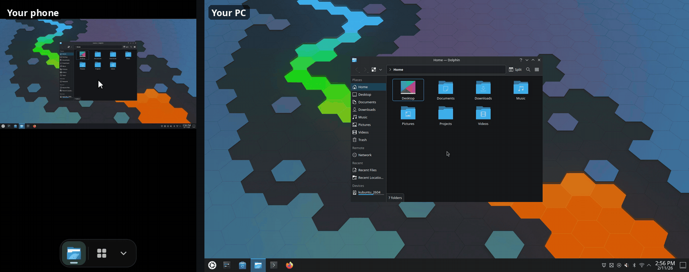
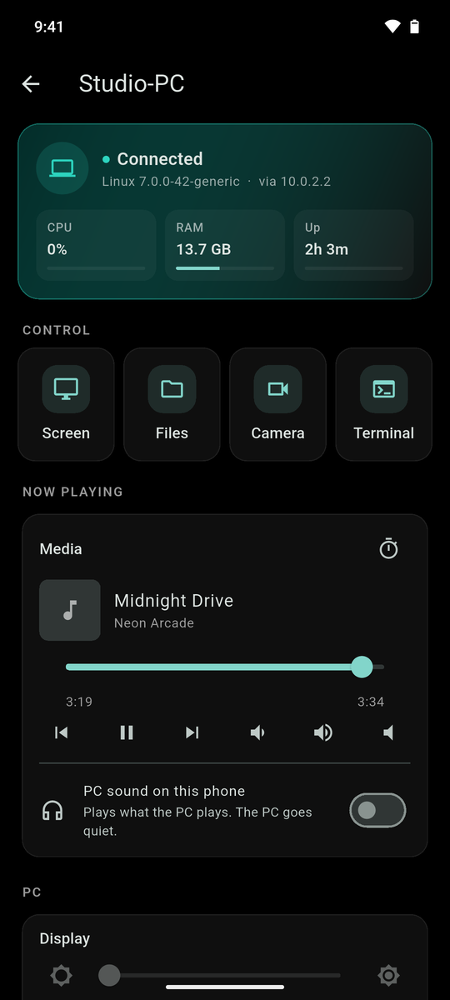
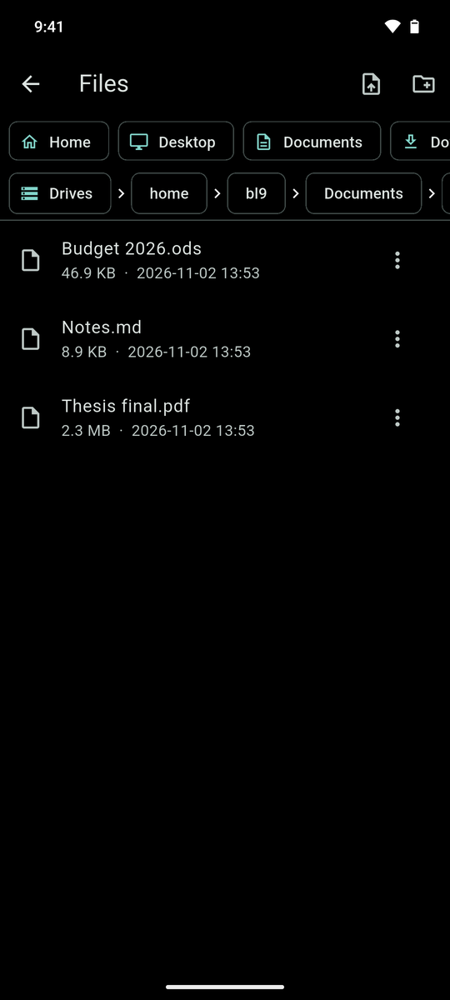
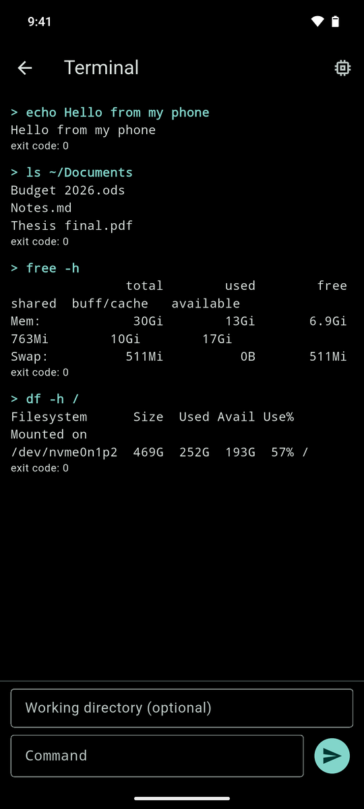

<div align="center">


# Sudo

**`sudo give me my PC`**: your Windows or Linux PC, in your Android phone.<br>
Its screen, files, terminal, music and sound. One tap to connect, no account, free.

[](https://github.com/loueylahwel/sudo/releases/latest)
[](https://github.com/loueylahwel/sudo/releases)
[](#what-works-where)
[](#download)
[](LICENSE)
[](https://github.com/loueylahwel/sudo/actions/workflows/agent-platforms.yml)

</div>

<p align="center">
  <br>
  <sub>A real phone driving a PC (played 1.5× faster): drag on the phone's touchpad to move the cursor, tap to click, two fingers to scroll.</sub>
</p>

## Why Sudo

- **One tap to connect.** Open the app, tap **Find my PC**, tap your PC's
  name. The first time, the PC asks you to allow the phone. No codes, no QR,
  nothing to set up.
- **No account, no subscription, no company in the middle.** At home the
  phone talks straight to the PC over your Wi-Fi.
- **More than remote desktop.** Files both ways, a terminal, what's playing
  and the volume, the PC's sound through your phone or headphones, the
  webcam, sleep and shutdown timers.
- **Away from home too.** Pair once at home, then reach the PC from mobile
  data or any Wi-Fi, without opening ports on your router. The connection
  stays encrypted end to end.
- **Free and open source** (MIT). The PC side is a small Python agent, the
  phone app is Flutter.

## Download

| | Download | Needs |
|---|---|---|
| **Android phone** | [sudo.apk](https://github.com/loueylahwel/sudo/releases/latest/download/sudo.apk) | Android 10 or newer |
| **Windows PC** | [Sudo-Service.exe](https://github.com/loueylahwel/sudo/releases/latest/download/Sudo-Service.exe) | Windows 10 or 11 (PC sound: version 2004 or newer) |
| **Linux PC** | [one command](#on-linux) | Ubuntu, Debian, Mint, Fedora, Arch, openSUSE and others; X11 or Wayland |

### On Windows

Run `Sudo-Service.exe` once. That's all: it runs invisibly, adds itself to
startup and starts at every boot. If Windows asks whether to allow it
through the firewall, say yes: that's how your phone finds the PC.

Updating: end the running Sudo first (Task Manager → Sudo-Service → End
task), put the new file in place of the old one and run it once.

### On Linux

```bash
git clone https://github.com/loueylahwel/sudo.git && cd sudo
bash agent/linux/install.sh
```

The installer adds a few system packages (apt, dnf, pacman or zypper), puts
the agent in `~/.local/share/sudo-agent` and starts it with your desktop
session. Re-run it after `git pull` to update. Logs:
`journalctl --user -u sudo-agent -f`.

### On the phone

1. Install `sudo.apk` (allow "install unknown apps" when Android asks).
2. Put the phone on the same Wi-Fi as the PC.
3. Open Sudo → **Find my PC** → tap your PC's name → allow it on the PC.

From then on the app reconnects by itself, at home and away.

## What it does

<table>
  <tr>
    <td width="33%"></td>
    <td width="33%"></td>
    <td width="33%"></td>
  </tr>
  <tr>
    <td align="center"><sub>Dashboard and Now Playing</sub></td>
    <td align="center"><sub>Files, both ways</sub></td>
    <td align="center"><sub>Terminal</sub></td>
  </tr>
</table>

- **Screen** with a live touchpad cursor and keyboard. Type from the phone
  as you go, in the PC's own keyboard layout. Switch between the PC's
  screens, lock the view to one window, zoom in to the PC's real pixels.
  Quality adapts to your Wi-Fi, up to full resolution with sharp text.
- **PC sound on your phone.** One switch: everything the PC plays comes out
  of the phone or its headphones, and the PC goes quiet. Works with the
  phone's screen off and away from home; if the phone drops off, the music
  pauses instead of blasting out of the PC's speakers.
- **Files**: browse the PC, download to the phone, upload to the PC.
- **Now Playing**: what the PC is playing, play/pause, skip, seek, volume.
- **Terminal** and the process list (end a stuck app from your bed).
- **Webcam**: see what the PC's camera sees.
- **Power**: lock, sleep, hibernate, restart, shut down, now or on a timer
  ("shut down in 30 minutes") with a countdown you can cancel.
- **Clipboard** both ways, **brightness**, an Alt-Tab style **app
  switcher** with live previews.

### What works where

| | Windows | Linux |
|---|---|---|
| Screen, touchpad, keyboard | Yes | Yes: X11, and Wayland on GNOME, KDE Plasma, Sway, Hyprland |
| Files, terminal, processes | Yes | Yes |
| Now Playing and media keys | Yes | Yes (any MPRIS player) |
| PC sound on the phone | Yes (Windows 10 2004+) | Yes (PipeWire) |
| Webcam | Yes | Yes |
| Power and timers, clipboard | Yes | Yes |
| App switcher and dock | Yes | KDE Plasma |
| Brightness | Yes | KDE Plasma |
| Away from home | Yes | Yes |

macOS isn't supported yet. If the PC can't show its screen (a locked
session, a Wayland desktop that needs permission), the phone says why and
how to fix it instead of showing a black picture.

## Private by design

- **Nothing to sign up for**, and no Sudo server: at home the phone and the
  PC talk directly, and nothing leaves your network.
- **The PC decides.** A phone it hasn't seen before can only connect once
  you click Allow on the PC.
- **Encrypted.** After pairing, the phone connects over TLS and checks the
  PC's own certificate, so nobody can pose as your PC.
- **Away from home**, the connection goes through your router (when it
  allows it) or a [Cloudflare](https://www.cloudflare.com/) tunnel that the
  PC opens outward, with no account needed. Either way it stays encrypted
  with the PC's certificate, so the tunnel only carries scrambled bytes. The
  tunnel's address reaches your phones through a secret
  [ntfy.sh](https://ntfy.sh) topic only they know.
- **Your choice.** Set `"remote_access": false` in the agent's
  `config.json` to stay home-only, or `"tunnel": false` to skip the tunnel.

Sudo gives the phone full access to the PC's files and a terminal: that's
the point. Install the agent only on PCs you own.

## How it works

```
   PC: Sudo agent (Python)                       Phone: Sudo app (Flutter)
 ┌──────────────────────────┐   UDP 47809      ┌─────────────────────────┐
 │ "I'm here" beacon         │ ───────────────▶ │ Find my PC              │
 │ screen, camera, sound     │   WebSocket      │ touchpad, keyboard      │
 │ files, terminal, media    │ ◀──────────────▶ │ files, terminal, media  │
 │ TLS port (paired phones)  │   8080 / 8443    │                         │
 └──────────────────────────┘                  └─────────────────────────┘
```

The PC announces itself on the Wi-Fi with a small UDP beacon, so the app
finds it by name even after its IP changes. The screen is JPEG frames that
follow the link's speed (or H.264 in the beta "Smooth video" mode); the PC's
sound is Opus. The wire protocol is in [docs/protocol.md](docs/protocol.md).

Every change is checked on GitHub's machines: the Linux installer and screen
capture on Ubuntu, Debian, Fedora, Arch and openSUSE, Wayland screen sharing
on Sway, and on Windows the built exes themselves: pairing, screen frames
and PC sound on a virtual sound card.

## Building from source

| Part | Stack | Build |
|---|---|---|
| `agent/` | Python 3.11+ | `pip install -r agent/requirements.txt`; Windows exes: see [windows-exes.yml](.github/workflows/windows-exes.yml) |
| `app/` | Flutter | `cd app && flutter pub get && flutter build apk --release` |
| `relay/` | Node.js 18+ | optional standalone relay: `npm install && npm start` |

Layout: `agent/` (PC agent, Python), `app/` (phone app, Flutter),
`relay/` (optional relay), `docs/` (protocol, Linux notes), `scripts/`
(tests and measuring tools).

## Contributing

Bug reports, ideas and pull requests are welcome: see
[CONTRIBUTING.md](CONTRIBUTING.md). Found a security problem? Please read
[SECURITY.md](SECURITY.md) first.

## License

[MIT](LICENSE)
